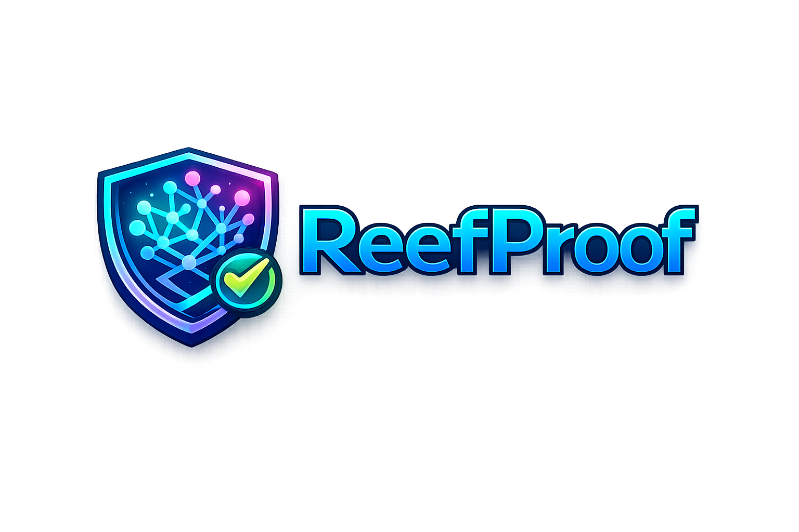
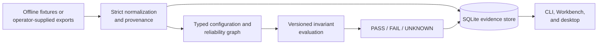
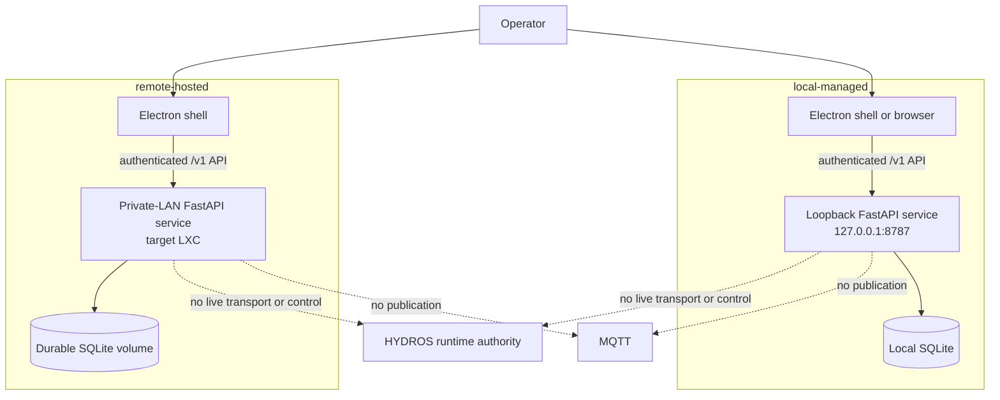

<p align="center">
  
</p>

# ReefProof

ReefProof 0.1.0 is an offline configuration-assurance workbench for living
systems. It normalizes explicit local evidence, builds typed reliability
graphs, evaluates versioned safety invariants, and preserves results in SQLite.
Operators can use the CLI, the browser Workbench, or the macOS desktop shell.

HYDROS remains runtime authority.

> ReefProof may observe, model, challenge, and alert on a living system. It may not silently take control of one.

v0.1.0 has no live HYDROS transport. It cannot change controller configuration
or equipment, publish MQTT messages, or perform automatic remediation. Bundled
examples are synthetic; manual Workbench evidence is labeled
`MANUAL / NOT LIVE`.

## Project overview

ReefProof turns operator-supplied configuration evidence into deterministic,
traceable assurance results:

- strict configuration normalization with explicit provenance;
- typed physical and reliability graphs;
- versioned invariants with `PASS`, `FAIL`, and `UNKNOWN` results;
- immutable project, evaluation, trust, session, and operation evidence in
  SQLite;
- a loopback browser Workbench and dual-mode Electron presentation shell; and
- a standalone CLI and OCI image for reproducible local or private-LAN use.

The backend is authoritative for authentication, policy, and evidence. Browser
and desktop clients never connect to HYDROS or MQTT, and the desktop renderer
has no filesystem, shell, process, preload, or generic IPC authority.

## Quick start

Prerequisites are macOS or Linux, CPython 3.13, `uv`, Git, and Make. Desktop
development additionally requires Node.js 22.12 or newer.

```bash
make setup
./reefproof version
./reefproof doctor
./reefproof snapshot --fixture tests/fixtures/configuration/authored-minimal.json
./reefproof check --fixture tests/fixtures/configuration/unsafe-correlated-returns.json
./reefproof explain RP-CIRC-001
```

Run `./reefproof` in an attached terminal for the guided menu and searchable
command palette. To start the loopback Workbench:

```bash
./reefproof serve
```

`serve` opens the Workbench after it is ready. Use `./reefproof serve --no-open`
when managing the browser yourself. The initial login uses a configured or
startup-generated bootstrap secret, followed by six-digit authenticator codes
after authenticator-app enrollment.

The repository-root launcher uses the development environment by default. Set
`REEFPROOF_ENV=prod` to select a previously verified standalone artifact.
Run `make help` and the domain helpers such as `make run/help`,
`make test/help`, and `make build/help` for the canonical commands.

Principal CLI commands include:

- `version`, `doctor`, and `status` for build and runtime information;
- `snapshot`, `hydros-check`, `graph`, `check`, and `explain` for assurance;
- `infra-smoke` for the network-free persistence scenario;
- `database schema|inspect|verify|backup|restore` for bounded SQLite operations;
- `serve` and `daemon start|stop|status|restart` for the local Workbench; and
- `auth sessions|revoke-session|totp` for sessions and authenticator apps.

## Architecture

### Evidence flow



Input is local and explicit. Unknown vendor semantics remain `UNKNOWN`; names
or topology are not inferred from private exports. SQLite is the authoritative
local evidence store and uses WAL mode.

### Runtime and authority boundaries



`local-managed` exclusively owns its bundled loopback service. `remote-hosted`
connects only to one explicit private-LAN ReefProof origin and performs no local
runtime, PID, database, or evidence-store operation. The selected backend is
always authoritative.

### API contract

JSON, health, status, findings, metrics, project, database, Workbench, and
operations APIs are under `/v1`. HTML Workbench pages and `/assets` are the only
unversioned presentation surface. OpenAPI is available at
`/v1/openapi.json`, with a self-contained read-only reference at `/v1/docs`.
Protected reads and all mutations use the `operatorSession` security contract.

## Environment variables

Configuration is loaded from strict YAML selected by `REEFPROOF_CONFIG_PATH`,
then overridden by supported environment variables. Do not commit secrets or
private system identifiers.

| Variable | Purpose | Default or constraint |
| --- | --- | --- |
| `REEFPROOF_ENV` | Select the repository launcher target | `dev`; use `prod` for `dist/reefproof` |
| `REEFPROOF_ENVIRONMENT` | Runtime environment | `development`; production disables reload |
| `REEFPROOF_CONFIG_PATH` | Strict YAML configuration file | No file by default |
| `REEFPROOF_DATA_DIRECTORY` | SQLite, PID, log, and runtime data root | `.local/data`; OCI uses `/var/lib/reefproof` |
| `REEFPROOF_HISTORY_FILE` | CLI command-history path | Under the data directory |
| `REEFPROOF_TIMEZONE` | IANA timezone | `America/New_York` |
| `REEFPROOF_LOG_LEVEL` | Application log level | `INFO` |
| `REEFPROOF_JSON_LOGS` | Enable JSON logs | `false` |
| `REEFPROOF_MODE` | Assurance mode | `fixture`, `one-shot`, or `watch` |
| `REEFPROOF_API_BIND` | API bind address | Loopback unless non-loopback is explicitly allowed by the hosted profile |
| `REEFPROOF_API_PORT` | API port | `8787` |
| `REEFPROOF_BOOTSTRAP_SECRET` | Initial operator-session secret | Generated per start if not configured |
| `REEFPROOF_BACKUP_DIRECTORY` | Root for server-created backups | Required for production server-selected backups |
| `REEFPROOF_PROJECT_ID` | Stable project identifier | `primary-reef-system` |
| `REEFPROOF_PROJECT_DISPLAY_NAME` | Human-readable project label | `Primary Reef System` |
| `REEFPROOF_AUTHORITY_PRINCIPAL_ID` | Stable acceptance-authority identity | `local-acceptance-authority` |
| `REEFPROOF_AUTHORITY_DISPLAY_NAME` | Acceptance-authority display label | `Local acceptance authority` |
| `REEFPROOF_DESKTOP_MODE` | Desktop connection mode | `local-managed` or `remote-hosted` |
| `REEFPROOF_REMOTE_ORIGIN` | Remote desktop backend | Required in remote mode; explicit private IP origin only |
| `REEFPROOF_HOSTED_RESTART_MODE` | Hosted restart adapter | `supervised-self-terminate` in production |

Optional Home Assistant alert delivery uses
`REEFPROOF_HOME_ASSISTANT_ENDPOINT` and `REEFPROOF_HOME_ASSISTANT_TOKEN`; it is
deferred from v0.1 release claims and must target an explicit loopback or private
IP address. See [the operations contract](docs/operations.md) for its fail-closed
network and credential boundary.

## Development and verification

```bash
make check
make build
make build/desktop-app
```

`make check` runs the canonical Python, generated-contract, browser, and desktop
quality gates. `make build` stages allowlisted committed inputs and verifies the
standalone CLI, OCI image, SPDX SBOM, build manifest, and checksums. Desktop
packaging independently builds and verifies the unsigned macOS application.

Local success does not imply hosted CI, signing, notarization, publication, or
deployment success. Release evidence must identify the exact candidate commit
and report untested boundaries honestly.

## Deployment

### Local browser Workbench

```bash
./reefproof serve
# Or keep browser launch under operator control:
./reefproof serve --no-open
```

Local service startup is loopback-only. For detached development use, use the
bounded `./reefproof daemon start|stop|status|restart` commands; production
lifecycle remains the deployment supervisor's responsibility.

### macOS desktop

Run the source-development Electron shell or build the unsigned application:

```bash
make run/desktop
make build/desktop-app
make run/desktop-app
```

The package is written beneath
`dist/desktop/ReefProof-darwin-<node-arch>/ReefProof.app`. It is unsigned and
unnotarized, with no DMG, installer, automatic updater, universal binary, or
non-macOS package.

Select the hosted backend explicitly for source acceptance:

```bash
REEFPROOF_DESKTOP_MODE=remote-hosted \
REEFPROOF_REMOTE_ORIGIN=http://192.168.1.20:8787 \
  make run/desktop
```

Use the actual private LXC address. HTTP is accepted only for a literal private
address and is visibly marked as reduced-security transport; HTTPS is preferred.
Public and special-use destinations, URL credentials, paths, queries,
fragments, and cross-origin redirects fail closed.

### OCI image on a private-LAN LXC

Build the complete bundle from a clean committed tree:

```bash
make build
```

Deploy published images by immutable digest. The image runs as the unprivileged
`reefproof` user, defaults to the `version` command, and requires writable
persistent storage at `/var/lib/reefproof` even when the container root is
read-only. A hardened offline smoke check is:

```bash
podman run --rm --read-only --read-only-tmpfs=false \
  --tmpfs /tmp:rw,noexec,nosuid,nodev --network=none --cap-drop=all \
  --volume reefproof-data:/var/lib/reefproof \
  ghcr.io/bobbravo2/reefproof@sha256:DIGEST infra-smoke --format json
```

A representative hosted invocation is:

```bash
podman run --detach --name reefproof-workbench \
  --restart=always \
  --read-only \
  --volume reefproof-data:/var/lib/reefproof \
  --publish PRIVATE_LXC_ADDRESS:8787:8787 \
  --env REEFPROOF_ENVIRONMENT=production \
  --env REEFPROOF_HOSTED_RESTART_MODE=supervised-self-terminate \
  ghcr.io/bobbravo2/reefproof@sha256:DIGEST \
  serve --bind 0.0.0.0 --port 8787 --no-open
```

`PRIVATE_LXC_ADDRESS` must be an explicit address assigned to the private LXC;
never publish the host side on `0.0.0.0` or permit public ingress. The external
supervisor owns lifecycle and private-LAN publication. Back up and verify the
SQLite database before volume maintenance; removing or replacing the volume can
destroy evidence.

The release candidate is not deployment-accepted until the exact immutable OCI
artifact passes target-LXC first boot, authentication, persistence, hosted
backup download, supervised service restart, LXC restart, and no-public-ingress
checks. Full steps and recovery constraints are in
[the operations contract](docs/operations.md).

### Database backup and restore

Use ReefProof's SQLite-aware commands rather than copying a live main database
without its WAL sidecars. Destinations must be new and are never overwritten.

```bash
./reefproof database verify
./reefproof database backup /safe/new/reefproof-backup.sqlite3
./reefproof database restore /safe/reefproof-backup.sqlite3 /new/reefproof.sqlite3
```

## Documentation

- [Product context](docs/product-context.md)
- [v0.1.0 release criteria](docs/release-criteria.md)
- [Roadmap and later integration points](docs/roadmap.md)
- [Architecture decisions](docs/architecture-decisions.md)
- [Operations contract](docs/operations.md)
- [v0.1 LXC deployment validation](docs/v0.1-lxc-deployment-validation.md)
- [Open questions](docs/open-questions.md)
- [Contributing](CONTRIBUTING.md)
- [MIT license](LICENSE)
- [Security policy](SECURITY.md)
- [Code of conduct](CODE_OF_CONDUCT.md)
- [Open-source release checklist](docs/open-source-release-checklist.md)

Historical plans and evidence ledgers are retained under `docs/plans/` and
`docs/archive/`; they are not current release status.
